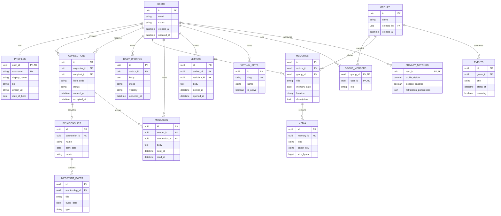
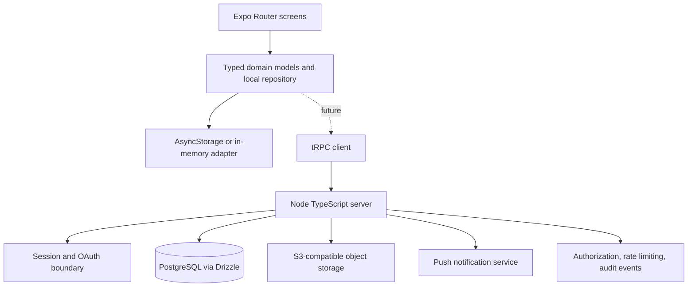

# HAMI Architecture and MVP Plan

## Executive Decision

HAMI will be implemented as a cross-platform Expo / React Native client with TypeScript. The first delivered slice uses local state so the core product experience can be evaluated without unsafe fake accounts or remote private data. The code is organized so the local domain model can later be replaced by server-backed repositories without changing screen-level interaction design.

The scaffold already provides a Node / TypeScript server, tRPC client, Drizzle database setup, OAuth callback route, and storage helpers. These are extension points for the production phase. They are intentionally not wired into the first experience until the authentication, authorization, storage, and privacy policies are implemented together.

## Product Boundaries

The initial implementation makes the emotional loop tangible: open Home, understand the relationship context, see what happened Today, send a message, preserve a Memory, and use lightweight connection rituals such as Letters and Gifts. Group collaboration, realtime transport, push delivery, media upload, admin moderation, and monetization remain explicit next modules rather than half-implemented controls.

| Area | MVP treatment | Production extension |
|---|---|---|
| Identity | Local demo profile and relationship context | Email verification, password recovery, OAuth, secure sessions |
| Connection | KURA code display and request state UI | Server-side invite tokens, acceptance flow, authorization checks |
| Home | Relationship dashboard with current date calculations | Server-sourced relationship, birthday, presence, and notification data |
| Today | Local daily updates with mood and visibility | Encrypted/private API, media upload, location consent and expiration |
| Chat | Local conversation list and message composer | Realtime WebSocket transport, read state, reactions, attachment pipeline |
| Memories | Local timeline and On This Day card | S3-compatible media, signed URLs, search indexes, export/delete workflows |
| Letters / Gifts | Local compose and send feedback | Scheduled delivery, notification queue, extensible gift catalog |
| Groups | More screen extension point | Group membership, roles, calendar, announcements, shared media |

## Domain Model

The production relational model should keep private visibility explicit instead of relying on client filters. Core tables include `users`, `profiles`, `connections`, `relationships`, `groups`, `group_members`, `messages`, `message_reactions`, `media`, `albums`, `memories`, `daily_updates`, `moods`, `events`, `birthdays`, `anniversaries`, `countdowns`, `virtual_gifts`, `gift_transactions`, `letters`, `scheduled_messages`, `bucket_lists`, `bucket_list_items`, `goals`, `notifications`, `reports`, `blocks`, and `privacy_settings`.

Each user-owned row should include a stable identifier, `created_at`, `updated_at`, and an owner or audience reference. Visibility should be modeled as a typed policy such as `private`, `connection`, `group`, or a join table of explicit viewers. All relationship and group membership queries must scope by the authenticated user before returning data.

## ER Diagram

## Application Architecture

## API and Authentication Architecture

The server should expose typed procedures grouped by domain: `auth`, `profiles`, `connections`, `relationships`, `dailyUpdates`, `messages`, `memories`, `letters`, `gifts`, `groups`, and `notifications`. Input schemas should be shared and validated with Zod. The server context should derive the authenticated principal from a secure session and every procedure should enforce resource ownership or explicit audience membership.

Authentication should support email registration with password hashing, email verification, recovery tokens, and OAuth providers. Access tokens should be short-lived and refresh tokens should be stored securely. The client should never persist raw passwords. OAuth provider secrets belong in the server environment, not in the mobile bundle.

## Storage and Privacy Architecture

Media uploads should use a server-issued signed upload URL with content-type and size validation. Object keys should be opaque and scoped by user or private space. Reads should use short-lived signed URLs and must be authorized before a URL is issued. Location sharing is disabled by default, explicitly scoped to selected recipients, and expires automatically when the sharing window ends.

The app should support user-visible deletion and export operations. Destructive account actions require confirmation and a server-side workflow that removes or anonymizes dependent rows and revokes sessions. AI features, when introduced, must require an explicit per-feature consent flag and should receive only the selected content.

## Folder Direction

The current Expo structure remains the entry point. Screens belong under `app/`, reusable visual primitives under `components/`, domain types and adapters under `lib/`, request procedures under `server/routers.ts` or domain-specific router modules, and database definitions under `drizzle/` and `server/`. Translation dictionaries should live under `lib/i18n/`. Tests should cover pure date calculations, local repository transitions, and server authorization policies.

## Technical Risks

The highest risks are privacy leaks from under-scoped queries, media bandwidth and upload failures, realtime ordering and reconnection behavior, scheduled delivery reliability, and user confusion from too many modules. The first implementation reduces these risks by keeping the navigation shallow, making privacy labels visible, using a typed domain vocabulary, and avoiding pretend realtime or security claims before the server contracts are ready.

## Recommended Build Order

The recommended sequence is foundation and identity, private connection and relationship context, Today and Chat, Memories and media, important dates and letters, groups and shared planning, then notifications, moderation, AI consent, and premium architecture. This sequence preserves the product's emotional center while keeping the backend maintainable and portable.
